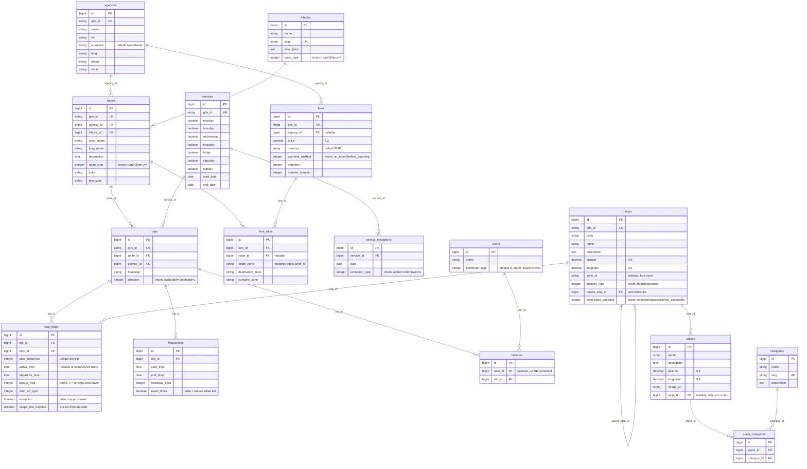

# Data Model

ERD and entity definitions, derived from `backend/db/schema.rb` at version
`2026_08_17_091000` and the association declarations in `backend/app/models/`.

The transit half of the schema mirrors [GTFS Schedule](https://gtfs.org/documentation/schedule/reference/)
one table per file, so the hand-collected feed in [`data/gtfs/`](../data/gtfs/)
maps across without translation. Every GTFS-derived table keeps the feed's own
identifier in a `gtfs_id` column, unique and indexed, which is what re-imports
match on.

## ERD



`created_at` / `updated_at` are omitted above; every table carries them.

## Entities

### GTFS-derived

| Table | GTFS file | Notes |
| --- | --- | --- |
| `agencies` | `agency.txt` | Operator of a route. Informal modes get an umbrella agency, since `routes.agency_id` is required. |
| `stops` | `stops.txt` | Boarding points. `location_type: :station` marks a terminal; its bays point back via `parent_stop_id`. |
| `routes` | `routes.txt` | A named origin–destination service for one mode. |
| `services` | `calendar.txt` | A weekly running pattern, reused by many trips. |
| `service_exceptions` | `calendar_dates.txt` | Holiday and fiesta overrides. |
| `trips` | `trips.txt` | One departure, or one representative run for a frequency-based route. |
| `stop_times` | `stop_times.txt` | The ordered stops of a trip, with times. |
| `frequencies` | `frequencies.txt` | "A vehicle roughly every N seconds between these hours." |
| `fares` / `fare_rules` | `fare_attributes.txt` / `fare_rules.txt` | Price, and where that price applies. |

`shapes.txt` has no table yet — the file exists in the feed but nothing imports
it. Add a `shape_points` table when route geometry is actually collected.

### `vihicles`

A mode of transport (tricycle, habal, mini jeep, bus, ferry). `route_type` holds
the GTFS code the mode's routes travel under: `3` for road vehicles, `4` for
ferry. GTFS has no code for tricycle or habal-habal, so both sit at `3` and the
`vihicle` association is what tells them apart. The feed carries the same
information in the non-standard `routes.mbtt_mode` column.

Seeded from `db/seeds.rb`, matched on `slug`.

### `places` and `categories`

A `place` is a destination a visitor picks (a beach, a church, a market) — not a
boarding point. `places.stop_id` points at the `stop` you board for to get there,
which is the link between "where I want to go" and "where I need to be".

Categories are many-to-many through `place_categories`: a place can be both
`Sea` and `Nature`.

### `users` and `histories`

`commuter_type` is an ActiveRecord enum with integer backing: `0 = local`,
`1 = traveller`. A `history` records that a user rode a given trip;
`History#vihicle` reaches the mode through `trip → route → vihicle`.

## Notable modelling decisions

- **Times live in `stop_times`, not on `trips`.** The old `trips.departure` /
  `trips.arrival` columns were removed — they duplicated the first and last
  `stop_time`. `Trip#departure`, `Trip#arrival`, and `Trip#duration_minutes`
  still read as before, now computed from the ordered `stop_times`, and return
  `nil` while a trip is only partly surveyed.
- **`trips.vihicle_id` was removed.** The mode belongs to the route, so
  `Trip#vihicle` is `has_one :through` and `Vihicle#trips` is
  `has_many through: :routes`. This stops a trip from disagreeing with its route
  about which vehicle runs it.
- **`History belongs_to :trip`.** The foreign key is `histories.trip_id`, so the
  previous `has_one :trip` on `History` (paired with `belongs_to :history` on
  `Trip`, for a column that never existed) pointed the association the wrong way
  and would have raised on use.
- **Frequency over timetable.** Tricycles, habal-habal, and most jeeps leave when
  full. They are modelled as one representative trip per route plus
  `frequencies` rows with `exact_times: false`, which is how GTFS expresses
  headway-based service. Fixed-schedule modes (ferry, bus, van) get one trip per
  real departure and no `frequencies` row.
- **`stop_times.timepoint` defaults to `false`.** Survey-derived times are
  estimates; flipping it to `true` is a deliberate claim that the time is exact.
- **`histories.user_id` has no database foreign key.** `trip_id` does. The
  asymmetry is inherited from the original migration and left as-is.
- **Spelling.** The model, table, controller, and foreign keys all use `vihicle`
  rather than `vehicle`. Consistent throughout, so nothing is broken, but
  renaming grows more costly as the API surface expands.

## Regenerating

This diagram is maintained by hand against `schema.rb`. For an auto-generated
image instead, the [`rails-erd`](https://github.com/voormedia/rails-erd) gem
produces PDF/PNG from the live models:

```ruby
# Gemfile
group :development do
  gem "rails-erd"
end
```

```sh
brew install graphviz   # required by rails-erd
bundle install
bundle exec erd         # writes erd.pdf
```
